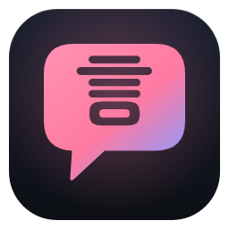
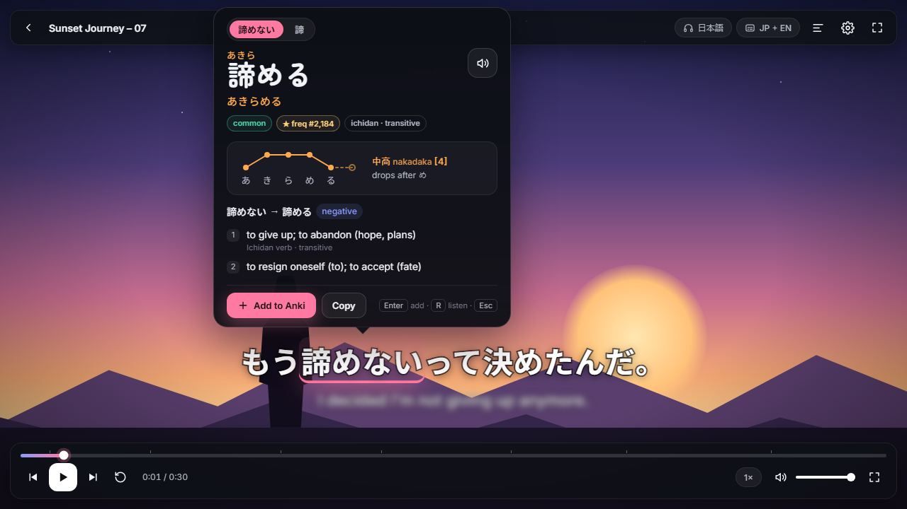
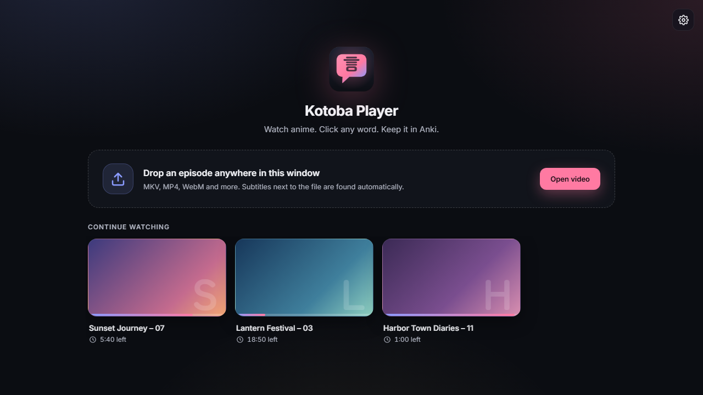
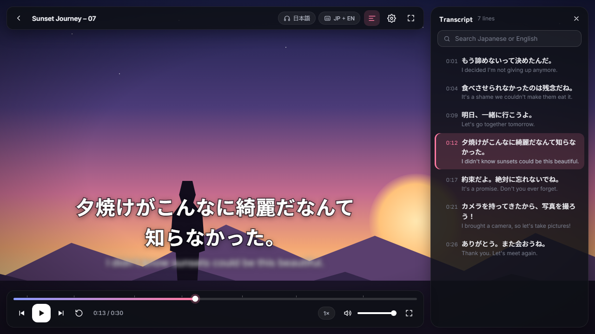
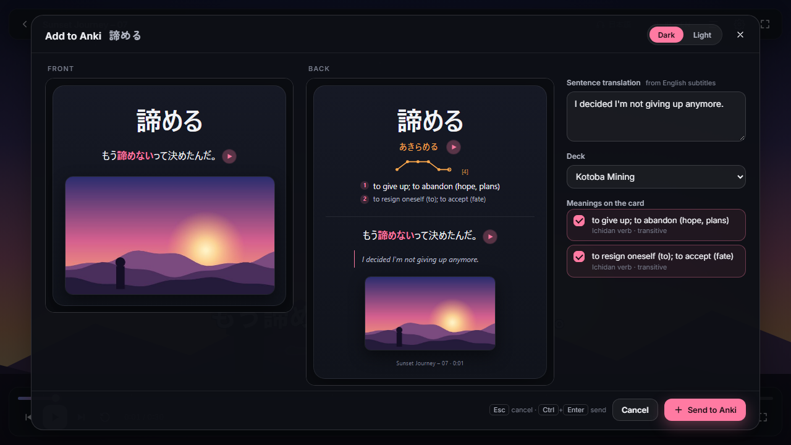
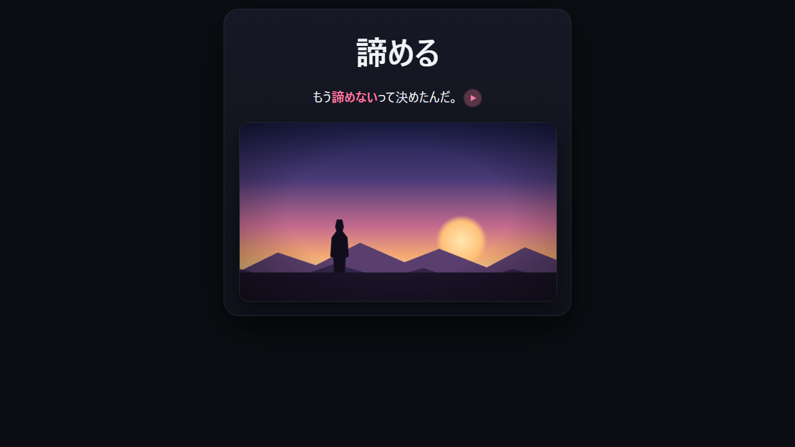
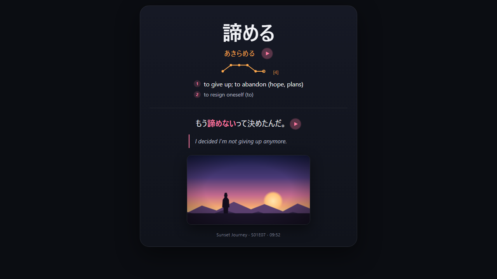
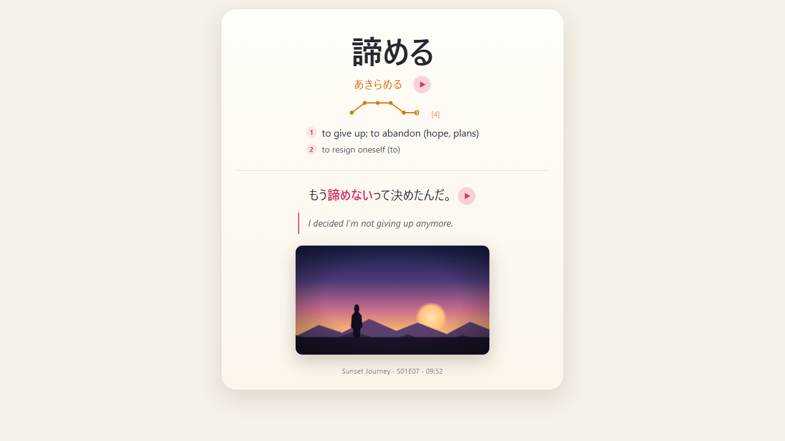
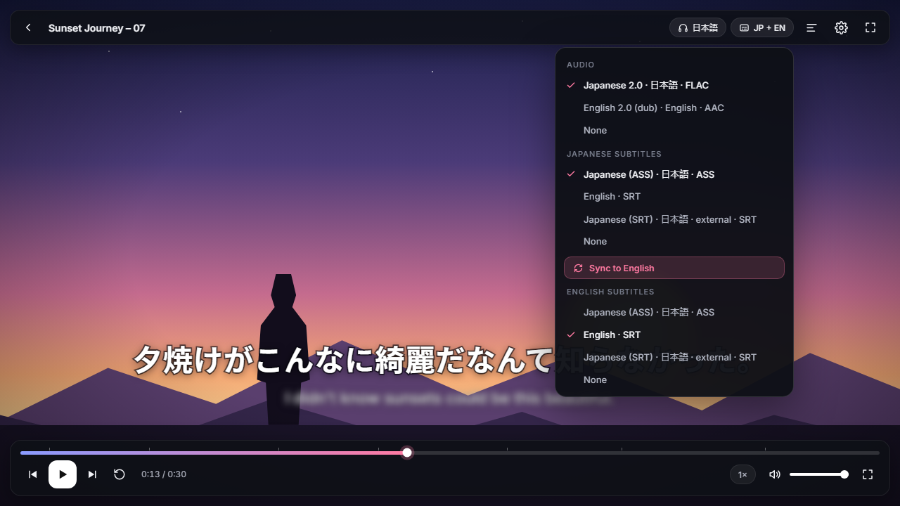

<div align="center">



# Kotoba Player

**Watch anime. Click any word. Keep it in Anki.**

A Windows video player for learning Japanese from anime. Click a word in the subtitles to see its meaning,
reading and pitch accent, hear it spoken, and make a ready-to-study Anki card with the sentence, a screenshot
and the real voice line — in one click.

[**Download for Windows**](https://github.com/Merunism19/kotoba-player/releases/latest) ·
[How to install](#install) · [How to use it](#using-it) · [Keyboard shortcuts](#keyboard-shortcuts) ·
[FAQ](#troubleshooting)



</div>

---

## What it does

- **Plays your anime files.** MKV, MP4, WebM, AVI, MOV, TS and more, through the mpv engine: 10-bit
  video, FLAC/AC3/DTS audio, multiple audio tracks, fonts and styled ASS subtitles all work.
- **Clickable Japanese subtitles.** The Japanese line is drawn as real text. Click anywhere in a word and it
  picks the **whole word** (夕焼け, 知らなかった — never a lone kanji), even when it is conjugated:
  clicking 食べさせられなかった finds 食べる and tells you *causative · passive · negative · past*.
- **A dictionary popup** with the English meanings, the kana reading (furigana above, reading below), a
  🔊 button, the **pitch accent** drawn as a graph (平板 / 頭高 / 中高 / 尾高), how common the word is, and
  other matches.
- **One-click Anki cards** with the word, the sentence, a screenshot of that moment, the sentence's real
  audio from the episode, the word's audio, the reading, pitch, meanings and the English translation of the
  sentence.
- **English subtitles underneath**, blurred until you hover them, so you read the Japanese first.
- **Study tools:** jump to the previous / next line, replay a line, a searchable transcript, pause while your
  mouse is over a line, and gold marks on the seek bar for lines you already mined.
- **Subtitle sync:** nudge the timing by ±100 ms, "this line starts now", or **Sync to English** — it
  automatically retimes a Japanese subtitle file to match the English track.
- **Private.** Everything runs on your PC. No account, no tracking. (Only exception, and only if you turn it
  on: a sentence you mine can be sent to DeepL for translation when the video has no English subtitles.)

<table>
<tr>
<td width="50%"></td>
<td width="50%"></td>
</tr>
<tr>
<td align="center"><sub>Home: drop an episode, or continue where you left off</sub></td>
<td align="center"><sub>Transcript (T): every line, searchable, click to jump</sub></td>
</tr>
</table>

---

## Install

### 1. Kotoba Player

1. Go to the [**latest release**](https://github.com/Merunism19/kotoba-player/releases/latest) and download
   `Kotoba.Player_<version>_x64-setup.exe` (about 140 MB — the video engine, ffmpeg and the full dictionary
   are included, so nothing else needs to be downloaded later).
2. Run it. **Windows SmartScreen may warn** that the app is from an unknown publisher (the installer isn't
   code-signed — signing certificates cost money). Click **More info → Run anyway**.
3. Click through the installer. It installs for your user only (no admin rights needed) and puts a
   **Kotoba Player** shortcut on your desktop and in the Start menu.

Requirements: **Windows 10 or 11, 64-bit.** The app uses Microsoft Edge WebView2, which Windows 11 already
has; on Windows 10 the installer fetches it if it is missing (needs internet once).

Updating: just run the newer installer. Your progress, settings and imported dictionaries are kept.

### 2. Anki + AnkiConnect (needed to make cards)

You can watch and look words up without Anki. To **send cards**:

1. Install [Anki](https://apps.ankiweb.net/) for desktop and open it.
2. In Anki: **Tools → Add-ons → Get Add-ons…**, paste the code **`2055492159`** (AnkiConnect), click OK,
   then **restart Anki**.
3. Keep Anki open while you watch. Kotoba Player finds it automatically (the **Add to Anki** button lights
   up; Settings shows *Connected to Anki*).

On first use the app creates its own note type, **Kotoba Mining**, and a deck of the same name (you can pick
any deck in Settings). It never edits or deletes your other notes, decks or note types.

### 3. Optional extras

| Want | Do this |
|---|---|
| **Hear words spoken** (🔊 / R) | Install a Japanese voice in Windows: **Settings → Time & language → Speech → Add voices → Japanese**. |
| **Nicer, natural word audio** with correct pitch accent | Install the free [VOICEVOX](https://voicevox.hiroshiba.jp/) and have it running. Kotoba Player uses it automatically when it is open (voice: 四国めたん, credited in the popup). |
| **Sentence translations for videos without English subs** | Make a free [DeepL API Free](https://www.deepl.com/pro-api) key and paste it in **Settings → Translation**. It is stored in Windows Credential Manager, not in a file. |
| **Offline machine translation** instead of DeepL | Install [Ollama](https://ollama.com/) and pull any model; Kotoba Player uses it when it is running. |
| **More dictionaries / frequency lists / pitch data** | **Settings → Dictionaries → Import**: any [Yomitan](https://github.com/yomidevs/yomitan)-format `.zip`. |

---

## Using it

### Open an episode

- **Drag a video file onto the window**, or click **Open video** on the home screen.
- **Subtitles inside the file** (most MKV releases) are found automatically.
- **Separate subtitle files** (`.ass`, `.ssa`, `.srt`, `.vtt`) are found automatically if they sit next to the
  video and their name starts with the video's name. Put the language in the name so the app knows which is
  which:

  ```
  Frieren - 07.mkv
  Frieren - 07.ja.ass     ← Japanese
  Frieren - 07.en.srt     ← English
  ```

- Or **drag a subtitle file onto the player** while the video is playing to add it.
- Pick audio, Japanese and English tracks from the **subtitle button** in the top bar (it shows e.g.
  `JP + EN`). The app remembers your choice, position and timing per file, and the home screen lists what you
  were watching under **Continue watching**.

> Kotoba Player only plays files you already have. Japanese subtitle files for anime are often shared by the
> community separately from the video — if their timing doesn't match your release, see
> [Fix subtitle timing](#fix-subtitle-timing).

### Look up a word

Hover the Japanese line: each word gets a faint underline (and the video pauses while your mouse is on the
line — you can turn that off). **Click a word** (or Tab to it and press Enter) to open the popup:

- the dictionary form with furigana, and the kana reading below it;
- 🔊 to hear it (or press **R**);
- the pitch-accent graph and its name, e.g. 中高 *nakadaka* [4] — *drops after め*;
- how the clicked form was conjugated (`諦めない → 諦める · negative`);
- numbered English meanings with their parts of speech;
- tabs at the top for other matches (e.g. 諦めない vs. 諦) — **← / →** switches between them, **↑ / ↓** between
  dictionary entries.

**Esc** closes the popup and playback continues.

### Make an Anki card

Press **Add to Anki** (or **Enter**) in the popup. A preview opens with the card's real front and back:



- **Sentence translation** is filled in for you: from the English subtitle line at the same moment, or DeepL,
  or Ollama (whichever is available, in that order). You can edit it.
- Untick meanings you don't want on the card, and pick the deck.
- If you already have this word in Anki, it says so (*Already in Anki*).
- **Send to Anki** (or **Ctrl+Enter**). The line gets a gold mark on the seek bar and in the transcript.

Want it faster? **Shift+click Add to Anki** (or **Shift+Enter**) skips the preview and adds the card directly.

### The card

| Front | Back |
|---|---|
|  |  |

- **Front:** the word, the sentence from the episode with the word highlighted (▶ plays the real line), and
  the screenshot.
- **Back:** the front stays exactly where it was. Under the word: the reading (▶ plays the word), the pitch
  graph and the meanings. Under the sentence: its English translation.
- **Hover any Japanese word** on the card to see its reading. On AnkiDroid / AnkiMobile, **tap** it.
- Works in Anki's **dark and light** modes and on phones. Cards are tagged `kotoba`, plus the show's name and
  any extra tags you set.

<details>
<summary>Light mode</summary>

</details>

### Fix subtitle timing

If the Japanese lines appear early or late:

- **Z / X** shift them by −/+100 ms (the step is adjustable in Settings). The offset shows in the top bar
  and is remembered for that file.
- **Shift+Z** — "this line starts now": press it the moment a character starts speaking the current line.
- **Sync to English** (in the subtitle menu): if the file also has English subtitles, the app retimes the
  Japanese track to match them automatically — useful when the Japanese subs come from a different release.
  It is remembered for that file and can be undone.



### Settings (Ctrl + ,)

- **Anki:** connection status, deck, extra tags.
- **Translation:** DeepL key and on/off, Ollama on/off and model.
- **Subtitles:** English line *blurred until hover* / *always* / *hidden*, subtitle size, pause while
  hovering a line, offset step.
- **Audio:** which word voice is in use (VOICEVOX or Windows).
- **Dictionaries:** import or remove Yomitan dictionaries.
- **Appearance:** accent colour (Sakura, Twilight, Matcha, Sunset).
- **About:** version, licences and dictionary credits.

---

## Keyboard shortcuts

**While watching**

| Key | Action |
|---|---|
| Space | Play / pause |
| ← / → | Back / forward 5 seconds |
| ↑ / ↓ | Volume up / down |
| A / D | Previous / next subtitle line |
| S | Replay the current line |
| Z / X | Subtitles earlier / later (by the offset step) |
| Shift + Z | Sync: the current line starts *now* |
| E | English line: blurred → always shown → hidden |
| T | Transcript |
| F | Fullscreen |
| Esc | Close the popup or menu / leave fullscreen |
| Ctrl + , | Settings |
| Tab, Enter | Move to a word in the subtitle and look it up |

**In the word popup**

| Key | Action |
|---|---|
| Enter | Add to Anki (opens the preview) |
| Shift + Enter | Add to Anki instantly, no preview |
| R | Hear the word |
| ← / → | Other matches |
| ↑ / ↓ | Other dictionary entries |
| Esc | Close |

**In the card preview:** Ctrl + Enter sends, Esc cancels.

---

## Troubleshooting

**"Add to Anki" is greyed out.** Anki isn't open, or AnkiConnect isn't installed. Open Anki, check
**Tools → Add-ons** lists AnkiConnect (code `2055492159`), restart Anki, and look at **Settings → Anki** in
Kotoba Player.

**No sound when I press 🔊.** Install a Japanese Windows voice (see [Optional extras](#3-optional-extras)) or
start VOICEVOX.

**No Japanese line appears.** Open the subtitle menu in the top bar and choose a Japanese track. If your
subtitles are a separate file, name it like the video plus `.ja.ass` / `.ja.srt` and put it in the same
folder, or drag it onto the player.

**The subtitles are out of sync.** Use **Z / X**, **Shift+Z**, or **Sync to English** — see
[Fix subtitle timing](#fix-subtitle-timing).

**The sentence translation on the card is empty.** The video has no English subtitles and neither DeepL nor
Ollama is set up. Type it in the preview, or add a DeepL key / start Ollama.

**Windows says the installer "isn't commonly downloaded" / unknown publisher.** The installer isn't
code-signed. Choose **More info → Run anyway**, or build it yourself from source (below).

**Where is my data?** Settings and watch progress: `%APPDATA%\com.merunism.kotoba`. Temporary files
(extracted subtitles, card media before it goes to Anki): `%LOCALAPPDATA%\com.merunism.kotoba`. The app never
writes anything into your video folders. Uninstall from **Windows Settings → Apps**.

Found a bug? [Open an issue](https://github.com/Merunism19/kotoba-player/issues) with the file type
(MKV/MP4…), where the subtitles came from, and what happened.

---

## How it works

```
┌──────── Kotoba Player window ────────────────────────────────────────────┐
│  UI (React, drawn in a transparent WebView2 on top of the video)          │
│   subtitles as clickable text · popup · card preview · settings           │
│  ─────────────────────────────────────────────────────────────────────── │
│  video (libmpv, drawn under the UI in the same window)                    │
└──────────────────────────────────────────────────────────────────────────┘
          │ typed commands / events
┌─────────▼──────── Rust core (Tauri) ─────────────────────────────────────┐
│ subtitles: ASS/SRT/VTT parser, encoding detection, signs vs. dialogue     │
│ jptext: Lindera + UniDic word splitting and readings                      │
│ jpdict: JMdict + Kanjium pitch in SQLite, conjugation rules, Yomitan imp. │
│ media: ffprobe/ffmpeg — tracks, subtitle extraction, audio clips, frames  │
│ anki: AnkiConnect (127.0.0.1:8765) · audio: VOICEVOX / Windows voice      │
│ translate: English track → DeepL → Ollama · sync: alass                    │
└──────────────────────────────────────────────────────────────────────────┘
```

- **Video:** mpv (via libmpv) plays the file and draws signs and songs from styled ASS subtitles. The
  dialogue line is drawn by the app as HTML so each word is clickable.
- **Subtitles:** the Rust core reads every track (extracting embedded ones with ffmpeg), detects the
  encoding (UTF-8, UTF-16, Shift_JIS), separates dialogue from signs and songs, and lines up the English track
  with the Japanese one by time.
- **Word lookup:** from the character you clicked, the app tries the longest possible text first, undoes
  conjugations with its own rule table, and looks each candidate up in JMdict — the same idea as Yomitan.
- **Cards:** the screenshot comes from mpv (without subtitles burned in), the sentence audio is cut from the
  episode by ffmpeg, and everything is sent through AnkiConnect with Anki's own furigana syntax so hover
  readings work everywhere.
- **Sync to English:** [alass](https://github.com/kaegi/alass) aligns the Japanese timings to the English ones.

More detail: [docs/DESIGN.md](docs/DESIGN.md).

---

## Build from source

Needs Windows 10/11 x64, [Node.js](https://nodejs.org/) 22 or newer, [pnpm](https://pnpm.io/), and
[Rust](https://rustup.rs/) (MSVC toolchain, with Visual Studio Build Tools 2022 "Desktop development with
C++").

```bash
pnpm install
node scripts/fetch-deps.mjs   # pinned libmpv, ffmpeg and dictionary sources (SHA-256 checked), the VC++ runtime from your Build Tools; builds the dictionary database
pnpm tauri dev                # run the app in development
pnpm tauri build              # make the installer → target/release/bundle/nsis/
node scripts/ci.mjs           # all checks: guards (licences, network, encoding), TypeScript, clippy, Rust tests, screenshot tests
```

Project layout and conventions: [docs/WORKFLOW.md](docs/WORKFLOW.md) and [docs/CODEMAP.md](docs/CODEMAP.md).

---

## Licence and credits

Kotoba Player is free software under the **[GNU GPL v3.0 or later](LICENSE)** (it includes libmpv and alass,
which are GPL).

It stands on the shoulders of:

- **[JMdict](https://www.edrdg.org/jmdict/j_jmdict.html)** — © the Electronic Dictionary Research and
  Development Group, used under [their licence](https://www.edrdg.org/edrdg/licence.html) (CC BY-SA 4.0).
- **[Kanjium](https://github.com/mifunetoshiro/kanjium)** pitch-accent data (CC BY-SA 4.0).
- **[mpv](https://mpv.io/)**, **[FFmpeg](https://ffmpeg.org/)** (LGPL build),
  **[Lindera](https://github.com/lindera/lindera)** + UniDic, **[alass](https://github.com/kaegi/alass)**,
  **[Tauri](https://tauri.app/)**, **[AnkiConnect](https://foosoft.net/projects/anki-connect/)**.
- **[VOICEVOX](https://voicevox.hiroshiba.jp/)** — 四国めたん voice, when you use it.
- Fonts: Inter, Noto Sans JP, Zen Maru Gothic (SIL Open Font License).

The full list with licences is in [THIRD-PARTY.md](THIRD-PARTY.md) and on the app's About screen.

Kotoba Player doesn't include, download or link to any anime or subtitles — bring your own files.
